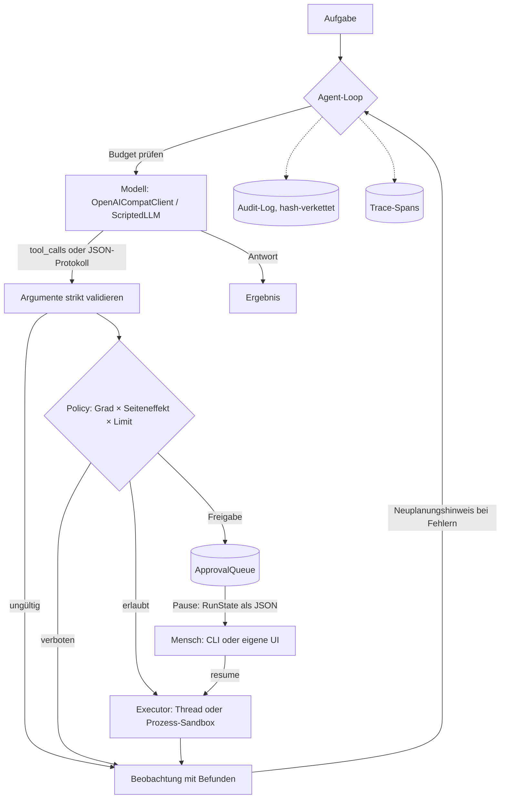

# gradweight-orchestration

[](https://github.com/GRADweight/orchestration/actions/workflows/ci.yml?query=branch%3Afeat%2Fqualitaet)

## In English

A small, auditable agent runtime for local LLMs (7–8B models via Ollama, or any
OpenAI-compatible server). Tools are plain typed Python functions; their JSON Schemas are
derived from type hints and docstrings, arguments are validated strictly, and models without
native tool calling fall back to a strictly parsed JSON protocol with repair retries. Every
call passes a policy that maps autonomy grades and declared side effects to "allow",
"needs human approval" or "deny"; runs pause for approval and resume later, and every step
lands in a hash-chained audit log. Untrusted tools run in a subprocess with enforced
timeouts and resource limits; the README states exactly what is and is not isolated.

## Worum es geht

Die Bibliothek führt einen Agenten (ReAct-Loop) mit lokalen Sprachmodellen aus und macht
dabei jeden Schritt prüfbar. Sie ist für Schweizer KMU-Prozesse gedacht, in denen ein Modell
Vorschläge macht und Werkzeuge aufruft, ein Mensch aber definierte Aktionen freigibt –
zum Beispiel Kreditorenrechnungen über einem Mandatslimit.

- **Echtes Tool-Calling:** typannotierte Funktionen werden zu JSON-Schemas; Argumente werden
  vor der Ausführung strikt validiert, Ergebnisse gegen den Rückgabetyp geprüft.
- **Für kleine Modelle gebaut:** natives `tools`/`tool_calls` der OpenAI-kompatiblen API,
  Rückfall auf ein JSON-Protokoll mit Korrekturschleife, Erkennung von Werkzeugaufrufen, die
  ein Modell in den Text statt ins `tool_calls`-Feld schreibt.
- **Governance im Kern:** Seiteneffekt pro Werkzeug, Autonomiegrad 01–05, Mandatslimit,
  Freigabe-Warteschlange mit Pause und Fortsetzung, hash-verkettetes Audit-Log.
- **Ehrliche Isolation:** erzwungene Zeitlimits, Subprozess mit Ressourcenlimits; was pro
  Plattform gilt und was nicht, steht unten – jeweils mit dem Test, der es nachweist.
- **Ohne Laufzeit-Abhängigkeiten:** nur Standardbibliothek; `httpx` und OpenTelemetry sind
  optionale Extras.

Status: Beta. Python ≥ 3.11, Linux und macOS. Nicht auf PyPI veröffentlicht.

## Schnellstart

Version 1.0 liegt bis zur Übernahme in `main` auf dem Zweig `feat/qualitaet`; der bisherige
Stand auf `main` ist eine andere, ältere Codebasis.

```bash
python -m pip install "gradweight-orchestration @ git+https://github.com/GRADweight/orchestration@feat/qualitaet"
gw-orchestration demo            # Kreditoren-Demo, offline, deterministisch
```

Oder aus einem Klon: `git clone -b feat/qualitaet https://github.com/GRADweight/orchestration.git`,
dann `python -m pip install .` im Ordner.

Ein eigener Agent mit zwei Werkzeugen. Das Beispiel nutzt das deterministische
`ScriptedLLM`, damit es ohne Modell läuft; alle Python-Blöcke dieses README werden in der CI
ausgeführt.

```python
from decimal import Decimal
from typing import Annotated

from gradweight_orchestration import (
    Agent,
    AutonomyGrade,
    Param,
    Policy,
    RunStatus,
    ScriptedLLM,
    ScriptedTurn,
    SideEffect,
    tool,
)


@tool(side_effect=SideEffect.READ_ONLY)
def offener_betrag(kunde: str) -> Decimal:
    """Liefert den offenen Betrag eines Kunden in CHF.

    Args:
        kunde: Kundennummer, z.B. K-1001.
    """
    return Decimal("1081.00")


@tool(side_effect=SideEffect.MONEY, amount_param="betrag")
def gutschrift(kunde: str, betrag: Annotated[Decimal, Param(ge=0)]) -> str:
    """Erstellt eine Gutschrift in CHF."""
    return f"Gutschrift für {kunde} über CHF {betrag}"


llm = ScriptedLLM(
    [  # Züge eines Modells; der Betrag kommt aus der Beobachtung
        ScriptedTurn.call("offener_betrag", {"kunde": "K-1001"}),
        lambda ctx: ScriptedTurn.call(
            "gutschrift", {"kunde": "K-1001", "betrag": ctx.last_result()}
        ),
        ScriptedTurn.final("Gutschrift über CHF 1'081.00 erstellt."),
    ]
)
agent = Agent(
    name="debitoren",
    llm=llm,
    tools=[offener_betrag, gutschrift],
    policy=Policy(grade=AutonomyGrade.MANDATE, money_limit=Decimal("500")),
)

result = agent.run("Schreibe Kunde K-1001 den offenen Betrag gut.")
assert result.status is RunStatus.PAUSED  # 1081 > Mandatslimit 500
request = result.pending_approvals[0]
print(request.reason)  # CHF 1'081.00 über Mandatslimit CHF 500.00

agent.approvals.approve(request.id, by="m.keller")  # Mensch gibt frei (auch per CLI möglich)
result = agent.resume(result.state)  # Zustand ist JSON-serialisierbar
assert result.ok and result.answer == "Gutschrift über CHF 1'081.00 erstellt."
assert agent.audit.verify().ok  # Hash-Kette intakt
```

Mit einem lokalen Modell über Ollama ändert sich nur das Modell-Objekt (nicht Teil der CI):

```python ollama
from gradweight_orchestration import OpenAICompatClient

llm = OpenAICompatClient(base_url="http://localhost:11434/v1", model="qwen2.5:7b-instruct")
```

## Konzepte

| Begriff | Bedeutung |
|---|---|
| Werkzeug | Typannotierte Funktion mit `@tool`; deklariert Seiteneffekt, Zeitlimit, Isolation. |
| Seiteneffekt | `READ_ONLY`, `REVERSIBLE` (umkehrbar), `IRREVERSIBLE`, `MONEY` (bewegt Geld). Ohne Angabe gilt `IRREVERSIBLE`. |
| Policy | Entscheidet pro Aufruf: erlauben, Freigabe verlangen, verbieten. |
| Lauf | Ein `run()`; Zustand (`RunState`) ist JSON und überlebt Prozessgrenzen. |
| Beobachtung | Strukturierte Rückmeldung an das Modell: `{"ok": true, "result": …}` oder `{"ok": false, "error": {"type": …, "message": …}}`. |
| Audit-Log | Hash-verkettete JSON Lines: Prompt-Hash, Werkzeug, Argumente, Ergebnis, Entscheid. |
| Trace | Spans pro Lauf, Modellaufruf und Werkzeugaufruf; JSON-Export, optional OpenTelemetry. |

## Architektur



Zusätzlich zum ReAct-Loop gibt es zwei Strategien: `PlanAndExecute` (das Modell erstellt zuerst
einen strikt geprüften Plan; jeder Schritt ist ein eigener Agent-Lauf; nach einem Fehlschlag
wird der Rest neu geplant) und `Supervisor` (ein Agent beauftragt Spezialisten, die eigene
Werkzeuge, eine eigene Policy und ein eigenes Budget haben; pausiert ein Spezialist für eine
Freigabe, pausiert der ganze Lauf).

## Wie Werkzeug-Schemas entstehen

`@tool` liest Signatur, Typannotationen und Docstring (Google-, NumPy- oder reST-Stil, auch
mit deutschen Abschnittsnamen wie `Argumente:`). Parameter ohne Default sind Pflicht,
unbekannte Felder werden abgewiesen (`additionalProperties: false`), und `Annotated[T,
Param(...)]` setzt Beschreibungen und Grenzen. Fehlende Annotationen, `*args` oder nicht
abbildbare Typen führen schon bei der Deklaration zu `ToolDefinitionError`.

| Python | JSON-Schema |
|---|---|
| `str`, `int`, `float`, `bool` | `string`, `integer`, `number`, `boolean` |
| `Decimal` | `number` (wird als `Decimal` übergeben) |
| `date`, `datetime` | `string` mit `format: date` bzw. `date-time` |
| `Literal[...]`, `Enum` | `enum` |
| `list[T]`, `tuple[T, ...]`, `dict[str, T]` | `array`, `object` mit `additionalProperties` |
| `T \| None`, `Union[...]` | Typliste mit `null` bzw. `anyOf` |
| Dataclass, `TypedDict` | `object` mit `properties`, `required`, `additionalProperties: false` |

```python
spec = gutschrift.spec()
assert spec["function"]["parameters"]["required"] == ["kunde", "betrag"]
assert spec["function"]["parameters"]["properties"]["betrag"] == {"type": "number", "minimum": 0}
```

Die Validierung ist bewusst streng: `"1081.00"` ist kein `number`. Das Modell erhält die
Befunde mit JSON-Pfad (`$.betrag: erwartet number, erhalten string '1081.00'`) und einen
Hinweis zur Neuplanung, damit es den Aufruf korrigieren kann. Nach `max_consecutive_errors`
Fehlschritten oder bei wiederholt identischen Aufrufen stoppt der Lauf.

`gw-orchestration schema modul:werkzeug` zeigt das Schema, wie es das Modell sieht.

## Tool-Calling mit kleinen Modellen

| Modus | Verhalten |
|---|---|
| `NATIVE` | `tools`-Feld der Chat-API. Steht ein Aufruf als JSON im Text statt in `tool_calls`, wird er erkannt, wenn er genau einem Werkzeug entspricht. |
| `JSON` | Werkzeuge im Systemprompt, Antwort im JSON-Modus (`response_format: json_object`) als genau ein Objekt `{"tool", "arguments"}` oder `{"final_answer"}`. Verstösse gehen mit Begründung zurück an das Modell (Standard: 2 Korrekturversuche). |
| `AUTO` (Standard) | beginnt nativ; meldet der Server, dass Modell oder Server keine Werkzeuge können, wechselt der Lauf auf `JSON`. |

`tool_choice` wird nicht gesendet, weil Ollama das Feld nicht unterstützt. Der Client nutzt
`urllib` (optional `httpx`), wiederholt bei Netzwerkfehlern, 408/409/425/429 und 5xx mit
exponentiellem Backoff und Jitter und beachtet `Retry-After`. `timeout_s` gilt bei `urllib`
pro Socket-Operation; die Gesamtdauer begrenzt das Zeitbudget des Agenten.

## Governance und Freigaben

Die Policy verbindet den Autonomiegrad (Begriffe aus dem
[GRADweight-Autonomiemodell](https://github.com/GRADweight/autonomy)) mit dem deklarierten
Seiteneffekt. Die Zuordnung ist eine Designentscheidung dieser Runtime, kein
Standard; sie wird in den Tests gegen den Code geprüft:

| Grad | lesend | umkehrbar | irreversibel | Geld |
|---|---|---|---|---|
| 01 Assistent | erlaubt | verboten | verboten | verboten |
| 02 Copilot | erlaubt | Freigabe | Freigabe | Freigabe |
| 03 Workflow | erlaubt | erlaubt | Freigabe | Freigabe |
| 04 Mandat | erlaubt | erlaubt | Freigabe | bis Limit |
| 05 Ausnahmebetrieb | erlaubt | erlaubt | erlaubt | bis Limit |

- **«bis Limit»:** erlaubt, wenn der Betrag (`amount_param`) bekannt ist und das Mandatslimit
  nicht überschreitet. Ohne Limit, ohne Betrag oder bei negativem Betrag: Freigabe
  (fail-closed). Mandatslimits gehören zusätzlich ins Zielsystem; die Policy ist die erste
  Linie, nicht die einzige.
- **Listen verschärfen nur:** `require_approval` und `deny` können eine Entscheidung strenger,
  nie lockerer machen (Property-Test).
- **Freigaben:** `ApprovalQueue` (SQLite) mit `approve`, `approve_with_changes`, `reject`.
  Entscheide sind atomar; Agenten (`by="agent:…"`) können nicht selbst freigeben. Für
  Menschen ohne eigene Oberfläche:
  `gw-orchestration approvals list|approve|reject --db freigaben.sqlite`.
- **Pause und Fortsetzung:** `RunResult.state` ist JSON; `agent.resume(state)` führt
  freigegebene Aufrufe aus, meldet Ablehnungen als Beobachtung und setzt den Loop fort – auch
  in einem anderen Prozess. Die Wartezeit zählt nicht zum Zeitbudget. Beim Fortsetzen wird
  die Policy erneut geprüft: eine Freigabe übersteuert kein Verbot (z.B. wenn das Werkzeug
  inzwischen auf der Sperrliste steht).
- **Audit-Log:** jede Station (Lauf, Modellaufruf mit Prompt-Hash, Policy-Entscheid,
  Freigabe, Werkzeugergebnis) als JSON-Zeile mit Hash des Vorgängers; `verify()` bzw.
  `gw-orchestration audit-verify` erkennt veränderte, gelöschte oder umsortierte Einträge.
  Mit `key=` wird HMAC-SHA256 verwendet. Ohne Schlüssel kann, wer Schreibzugriff hat, die
  ganze Kette neu berechnen; das Abschneiden am Ende fällt nur auf, wenn der letzte Hash
  (`AuditLog.head`) ausserhalb verankert wird.
- **Personendaten:** `Redactor` schwärzt E-Mail, IBAN, AHV-Nummer, Schweizer Telefonnummern
  und Kartennummern (mit Luhn-Prüfung) in Audit-Einträgen, wahlweise als HMAC-Pseudonym.
  Namen und Adressen erkennt er nicht.

## Isolation: was erzwungen wird

Jeder Werkzeugaufruf hat ein Zeitlimit. Im **Thread-Modus** (vertrauenswürdiger Code) kehrt
der Agent nach Ablauf sofort zurück; Python kann Threads nicht abbrechen, der Thread läuft im
Hintergrund weiter und wird gezählt (`ToolExecutor.abandoned_threads`). Im **Prozess-Modus**
(`isolation=Isolation.PROCESS`) läuft das Werkzeug in einem Kindprozess; die Limits werden
*vor* dem Import des Werkzeugcodes gesetzt, und `SIGKILL` geht an die ganze Prozessgruppe.

| Eigenschaft | Linux (nicht root) | Linux (root) | macOS | Nachweis |
|---|---|---|---|---|
| Hartes Zeitlimit, Prozessgruppe beendet | ja | ja | ja | `test_timeout_kills_hanging_tool`, `test_timeout_kills_grandchild_in_same_group` |
| Enkel mit `setsid` beendet (PID-Namespace) | ja¹ | ja | nein | `test_pid_namespace_kills_escaped_grandchild` |
| CPU-Zeit (`RLIMIT_CPU`) | ja | ja | ja | `test_cpu_limit_stops_busy_loop` |
| Adressraum (`RLIMIT_AS`) | ja | ja | nein² | `test_memory_limit`, `test_memory_limit_fails_closed_on_macos` |
| Dateigrösse (`RLIMIT_FSIZE`) | ja | ja | ja | `test_file_size_limit` |
| Keine neuen Prozesse (`RLIMIT_NPROC=0`) | ja | nur mit `run_as_user` | ja | `test_no_new_processes`, `test_run_as_unprivileged_user` |
| Saubere Umgebung, temporäres Arbeitsverzeichnis | ja | ja | ja | `test_clean_environment`, `test_temporary_working_directory_is_removed` |
| Kein Netzwerk (eigener Netzwerk-Namespace) | ja¹ | ja | nein³ | `test_network_isolation_blocks_loopback`, `test_deny_fails_closed_without_namespace` |
| Dateisystem | **nein** | **nein** | **nein** | `test_filesystem_is_not_isolated` |
| Systemaufruf-Filter (seccomp) | **nein** | **nein** | **nein** | – |

¹ Nur wenn der Kernel unprivilegierte User-Namespaces erlaubt (`unshare -r -n`). Auf den
GitHub-Runnern mit Ubuntu 24.04 sperrt AppArmor sie; die CI hebt die Sperre im Job
«Sandbox-Nachweise Linux» auf und führt die Tests dort als normaler Benutzer und als root aus. `gw-orchestration sandbox-info` zeigt,
was auf dem eigenen System gilt.
² macOS lehnt `RLIMIT_AS` ab; mit gesetztem `memory_mb` bricht die Sandbox fail-closed ab.
Auf macOS `memory_mb=None` setzen (oder bewusst `strict=False`).
³ `NetworkMode.DENY` (Standard) schlägt ohne Namespace fail-closed fehl; `DENY_IF_POSSIBLE`
führt aus und meldet `network_isolated: false`.

**Das ist keine Sicherheitsgrenze gegen feindseligen Code.** Der Kindprozess darf lesen und
schreiben, was der Benutzer darf, und Kernel-Schwachstellen bleiben erreichbar. Für fremden
oder vom Modell erzeugten Code: Container mit gVisor, Firecracker-MicroVMs oder ähnliche
Isolation verwenden. Die Tests laufen lokal unter Linux (als root und als normaler Benutzer)
und in der CI auf `ubuntu-24.04` und `macos-14`; Tests, deren Voraussetzung fehlt, werden mit
Begründung übersprungen.

## Beobachtbarkeit, Budgets, Gedächtnis

- **Trace:** Spans `invoke_agent <name>`, `chat <modell>`, `execute_tool <werkzeug>` mit
  Attributen nach den OpenTelemetry-Konventionen für generative KI (`gen_ai.*`, dort noch im
  Status «Development») und eigenen `gw.*`-Attributen (Prompt-Hash, Policy-Entscheid,
  Isolation). `tracer.export_json(pfad)`; mit dem Extra `otel` überträgt
  `OpenTelemetryExporter(provider).export(tracer.spans)` die Spans an OpenTelemetry.
- **Budgets:** Schritte, Token, Kosten (frei wählbarer Preis, lokal standardmässig 0) und aktive
  Laufzeit. Werkzeug-Zeitlimits werden auf die verbleibende Laufzeit begrenzt. Meldet der Server
  keine Token-Zahlen, wird geschätzt (≈ 4 Zeichen pro Token) und das Ergebnis als geschätzt markiert.
- **Kontextfenster:** `ConversationWindow(max_tokens=…)` lässt ältere Schritte als Ganzes weg
  (nie ein Werkzeugergebnis ohne seinen Aufruf); Systemprompt und Aufgabe bleiben.
- **Langzeitnotizen:** `LongTermMemory` (JSON Lines, BM25 über Wörter, ohne Embeddings) – für
  wiederkehrende Fakten, nicht für semantische Suche. Mit `remember=True` speichert der Agent
  eine geschwärzte Zusammenfassung abgeschlossener Läufe.

## Demo: Kreditorenprozess

`gw-orchestration demo` verarbeitet drei erfundene Rechnungen: Posteingang lesen → Rechnungstext
im Kindprozess parsen und rechnerisch prüfen (MWST 8,1 %, IBAN-Prüfziffer) → Lieferant und IBAN
gegen die Stammdaten abgleichen → Buchungsvorschlag (Aufwand und Vorsteuer 1170 an Kreditoren
2000, Konten nach KMU-Kontenrahmen) → Buchung im Mock-ERP mit Freigabe über dem Mandatslimit
von CHF 5'000. Das Mock-ERP prüft zusätzlich selbst (Betrag = Vorschlag, keine Doppelbuchung,
API-Limit, Zahlung nur an die Stammdaten-IBAN). Auszug der Ausgabe:

```text demo
  5. kreditor_buchen(vorschlag_id="V-0002", betrag_chf=12431.5, zahlung_am="2026-11-19")  [Policy: CHF 12'431.50 über Mandatslimit CHF 5'000.00]
  FREIGEGEBEN durch m.keller: Lieferung und Preis geprüft (simulierte Freigabe)
     → Beleg B-00002, CHF 12'431.50, Zahlung am 2026-11-19 (freigegeben durch m.keller)
     → Muster Bürobedarf AG (K-2001), IBAN WEICHT AB
  Gebucht: RE-2026-0042 CHF 1'081.00 (B-00001, Kreditor K-2001, Zahlung am 2026-11-19)
  Gebucht: AE-77812 CHF 12'431.50 (B-00002, Kreditor K-2002, Zahlung am 2026-11-19)
```

Optionen: `--grad 1..5`, `--limit`, `--freigabe simuliert|ablehnen|interaktiv`,
`--tool-calling auto|native|json`, `--ausgabe ORDNER` (Audit-Log, Trace, Freigaben).

Gegen ein lokales Modell (nicht Teil der CI, Ergebnisse hängen vom Modell ab):

```bash
ollama pull qwen2.5:7b-instruct
gw-orchestration demo --llm ollama --modell qwen2.5:7b-instruct
```

Andere OpenAI-kompatible Server: `--llm openai --base-url URL --modell NAME
--api-key-env VARIABLE`.

## Grenzen

- **Kein Sicherheitsprodukt.** Die Prozess-Isolation begrenzt Ressourcen und – wo verfügbar –
  Netzwerk, nicht das Dateisystem und keine Systemaufrufe (Tabelle oben).
- **Nicht gegen echte Modelle gemessen.** Die Tests nutzen ein Skript-Modell und einen lokalen
  OpenAI-kompatiblen Testserver, auch für den vollständigen HTTP-Pfad. Wie zuverlässig ein
  bestimmtes 7–8B-Modell Werkzeuge aufruft, ist hier nicht gemessen; dafür gibt es keine Zahlen
  in dieser Dokumentation.
- **Ein Prozess, kein Server.** Keine verteilte Ausführung, keine Warteschlange zwischen
  Maschinen, keine Weboberfläche für Freigaben (nur API und CLI).
- **Audit-Log ist manipulationserkennend, nicht -sicher**; ohne HMAC-Schlüssel und externe
  Verankerung des letzten Hashs lässt es sich neu schreiben.
- **Schwärzung ist musterbasiert** und erkennt keine Namen oder Adressen.
- **Token-Zählung** ist ohne Serverangaben eine Schätzung; das Kontextfenster ist daher
  ungefähr.
- **Kein Streaming**, keine Bild- oder Audioeingaben, keine Ausführung von Code, den das Modell
  schreibt.
- **Windows:** nicht unterstützt und nicht getestet; die Prozess-Isolation lehnt ohne POSIX ab
  (fail-closed).

## Einordnung

LangGraph modelliert Agenten als zustandsbehaftete Graphen mit Checkpointing und
Unterbrechungen für menschliche Eingriffe und ist für komplexe, verzweigte Abläufe deutlich
flexibler. smolagents von Hugging Face ist eine schlanke Bibliothek, deren `CodeAgent` Aktionen
als Python-Code formuliert und auf Wunsch in Sandboxes wie E2B oder Docker ausführt. Diese
Runtime ist kleiner und enger: nur JSON-Werkzeugaufrufe, keine Laufzeit-Abhängigkeiten, dafür
Freigabe-Policy, Hash-Ketten-Audit und dokumentierte Isolationsgarantien im Kern – gedacht für
lokale Modelle und für Abläufe, die eine Revision nachvollziehen muss.

## Entwicklung

```bash
uv venv && uv pip install -e ".[dev]"
ruff check . && ruff format --check . && mypy
python -m pytest --cov
```

Siehe [CONTRIBUTING.md](CONTRIBUTING.md), [SECURITY.md](SECURITY.md) und
[CHANGELOG.md](CHANGELOG.md).

## Lizenz und Kontakt

MIT, siehe [LICENSE](LICENSE). Kontakt: mail@gradweight.ch
